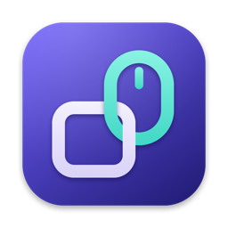
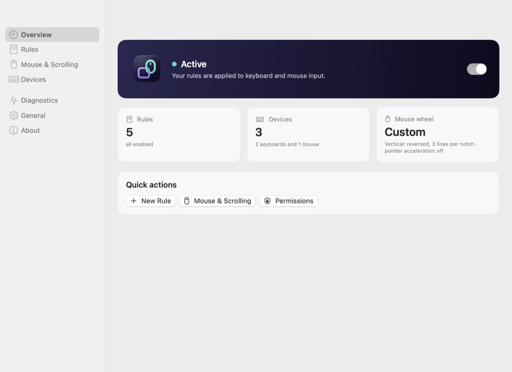
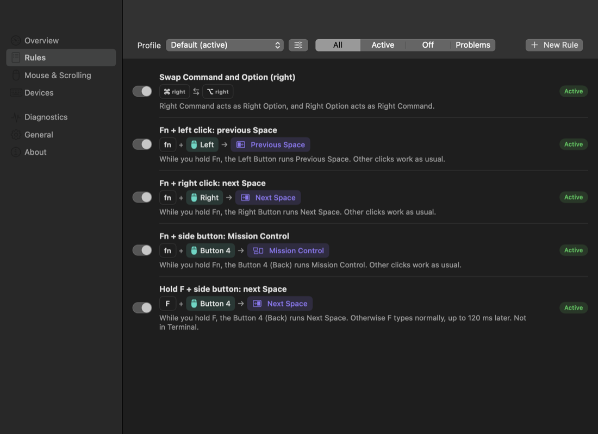
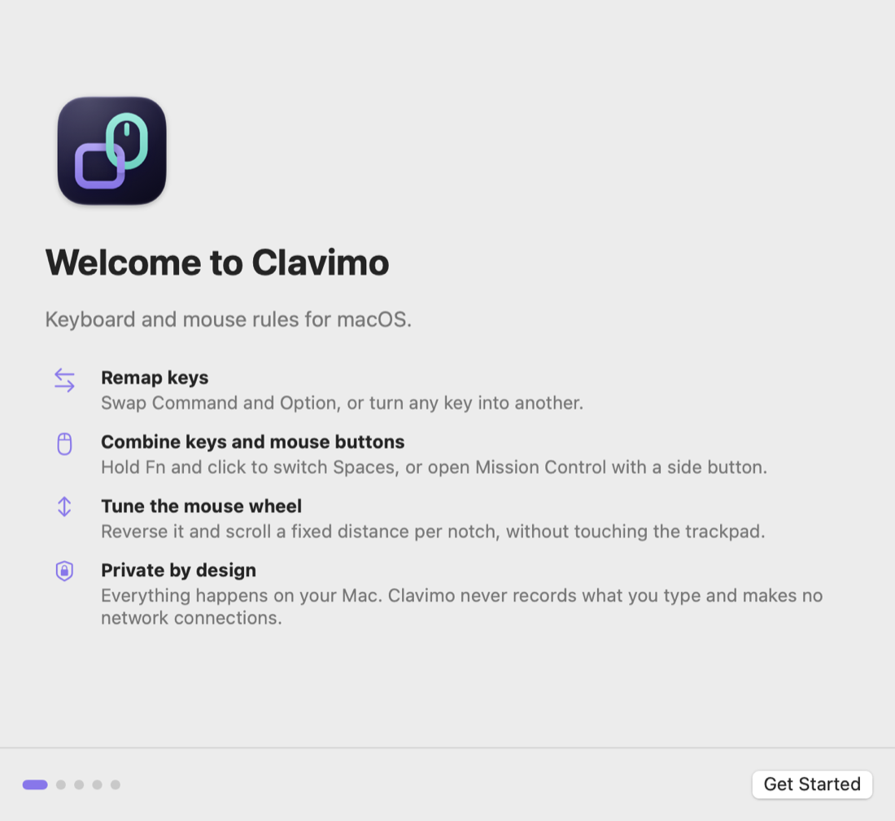
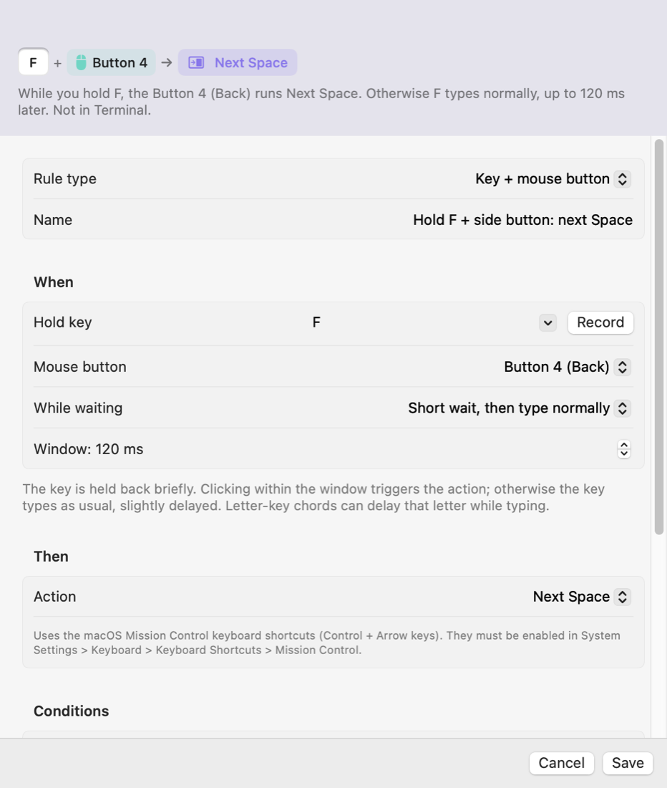

<p align="center"></p>

# Clavimo

**Keyboard and mouse rules for macOS.**

Clavimo is a native, open source menu bar app that remaps keys and combines your keyboard and mouse into shortcuts. Swap Command and Option, switch Spaces with Fn + click, open Mission Control with a side mouse button, hold a letter and click to run an action, or reverse the mouse wheel without touching your trackpad. Rules are created in a visual editor, stored in a readable JSON file, and processed locally on your Mac.

> **Project status: preview, heading for 1.0.** The latest release, 0.1.0, is a pre-release. The `main` branch contains the 1.0 candidate described below; it becomes 1.0 once every feature marked Available has passed the hardware checklist in [docs/testing.md](docs/testing.md). Clavimo is used daily by its maintainer on one Mac. See [Compatibility](#compatibility-and-limitations) before relying on it.

<p align="center">
  
  
</p>

## Features

| Feature | Status | Notes |
| --- | --- | --- |
| Swap or remap keys, including left and right Command, Option, Control and Shift separately | Available | Verified in daily use on a built-in MacBook keyboard. Caps Lock and Fn cannot be remapped. |
| Modifier + mouse button (including Fn, and left or right click with explicit opt-in) | Experimental | Ordinary clicks are never affected. |
| Letter key + mouse button, with a choice of how the letter is buffered | Experimental | The letter may be slightly delayed while typing; see [leader policies](docs/configuration.md#leader-policies-for-key--mouse-button). |
| Actions: next and previous Space, Mission Control, application windows | Experimental | Uses the macOS Control + Arrow shortcuts, which must be enabled. |
| Reverse the mouse wheel without changing the trackpad | Available | Verified in daily use with a USB Logitech G102. |
| Scroll distance per axis: system, accelerated, a fixed number of lines or pixels per notch, or smooth scrolling that glides each notch like a trackpad | Experimental | Applies to all mouse wheels; per-device scrolling is not supported yet. |
| Rules limited to apps or excluded from apps | Experimental | |
| Rules limited to one keyboard or mouse | Experimental | Works without a driver by asking devices which one is pressing the key; if that is ambiguous, the rule does not apply. Identical devices cannot be told apart. |
| Visual rule editor with key recording, rule templates and a live preview in words | Experimental | |
| Profiles that inherit the Default rules, switched from the menu bar | Experimental | |
| Export, import with a preview of the changes, and restoring the previous configuration | Experimental | |
| Diagnostics: event tap health, processing time, and an opt-in input inspector kept in memory only | Experimental | |
| First-launch guide for permissions, devices and a first rule | Experimental | |
| Pause for 5 minutes, 1 hour or until resumed; emergency disable and safe mode | Experimental | |
| English and Polish interface | Available | Follows the macOS language setting. |
| Launch at Login, automatic pause while another macOS account is active | Experimental | Multi-account behavior not yet verified on hardware. |
| Per-device pointer speed and scrolling, macros, layers, tap-hold, more languages | Planned | |
| Remapping at the login window or before FileVault unlock | Unsupported | macOS does not allow it for apps like Clavimo. |

**Available** means implemented, covered by automated tests and verified on real hardware. **Experimental** means implemented and covered by automated tests, but not yet verified on hardware, so it may not work everywhere. **Planned** features do not exist yet.

## Requirements

- macOS 14 Sonoma or later. Tested so far only on macOS 27.2 on Apple Silicon. Builds include Intel (x86_64) code, which has not been tested on an Intel Mac.
- To build: Xcode 16 or later (Swift 6).
- Permissions: **Accessibility** and **Input Monitoring**, granted per macOS account. See [Permissions and privacy](#permissions-and-privacy).

## Installation

### Download

1. Download `Clavimo-<version>.zip` from the [latest release](https://github.com/szulcmateusz/Clavimo/releases).
2. Double-click the zip and move **Clavimo.app** to your **Applications** folder.
3. Open Clavimo. macOS shows that Apple could not verify the app, because releases are **not notarized by Apple**: the project does not have a paid Apple Developer membership. Click **Done**.
4. Open **System Settings > Privacy & Security**, scroll down to the message about Clavimo and click **Open Anyway**, then confirm with your password. This is needed only once per version.

Never disable Gatekeeper or System Integrity Protection for Clavimo; it does not need it.

Releases are signed with the project's own self-signed certificate. That certificate is not trusted by Apple, but it stays the same across versions, so macOS keeps Clavimo's permissions when you update. To check that your download is intact, compare its checksum with the `.sha256` file published with the release:

```sh
shasum -a 256 Clavimo-0.1.0.zip
```

### Build from source

```sh
git clone https://github.com/szulcmateusz/Clavimo.git
cd Clavimo
scripts/setup-local-signing.sh   # optional, keeps permissions across rebuilds
scripts/build-app.sh --install   # builds and copies Clavimo.app to /Applications
open /Applications/Clavimo.app
```

`--install` copies the app to `/Applications` when that folder is writable (administrator accounts) and to `~/Applications` otherwise. Apps you build yourself are not quarantined, so Gatekeeper does not block them.

`setup-local-signing.sh` creates a self-signed code signing certificate in a separate keychain under `~/Library/Application Support/ClavimoDev`. Without it, the build is signed ad hoc and macOS forgets the app's permissions every time you rebuild.

## Getting started

<p align="center"></p>

1. **Open Clavimo.** On first launch a short guide walks you through permissions, your devices and a first rule. The Clavimo icon (a keycap linked with a mouse) appears in the menu bar. If your menu bar is full, the icon may be hidden behind the camera notch; open Clavimo again from Finder or Spotlight to show the settings window.
2. **Grant permissions.** Turn on Clavimo in **System Settings > Privacy & Security > Accessibility** and **Input Monitoring**. Clavimo notices within a few seconds; no restart is needed.
3. **Create a rule.** Pick a template in the guide, or in **Rules** click **New Rule**, choose a rule type, pick or record the keys, and click **Add Rule**. The preview at the top of the editor explains the rule in words. Rules apply immediately.
4. **Turn remapping on** with the switch in **Overview**, and decide in **General** whether it should be on when Clavimo starts.

<p align="center"></p>

### Example: swap Command and Option

Choose **Swap two keys**, record **Left Command** as the first key and **Left Option** as the second. Both directions are created: Command acts as Option and Option acts as Command, including in shortcuts such as Command + C. Left and right modifiers are separate keys, so add a second rule for the right side if you want it.

### Example: switch Spaces with Fn + click

1. In **System Settings > Keyboard > Keyboard Shortcuts > Mission Control**, make sure **Move left a space** and **Move right a space** are enabled (Control + Left Arrow and Control + Right Arrow by default).
2. Create a **Modifier + mouse button** rule: hold **fn**, **Left Button**, action **Previous Space**. Create a second one with **Right Button** and **Next Space**.

Only clicks made while Fn is held are replaced. Normal clicks, drags and right-click menus are not affected. Mouse side buttons (4 and 5) work the same way, unless a vendor tool such as Logi Options+ already intercepts them.

## How rules work

- **Rule types:** swap two keys, remap a key, modifier + mouse button, key + mouse button, and mouse wheel settings (direction and scroll distance per axis, set in **Mouse & Scrolling**).
- **Profiles:** every profile uses its own rules plus the rules of Default; a rule in a profile replaces a Default rule with the same trigger. Switch the active profile from the menu bar or the Rules pane.
- **Conditions:** only in certain apps, never in certain apps, and (experimental) only for a specific keyboard or mouse. Leave them empty to apply a rule everywhere.
- **Precedence:** for mouse chords with the same trigger, the higher priority wins, then the more specific conditions. Two rules for the same key need different conditions; the most specific one wins. Conflicting rules are rejected when you save, with an explanation.
- **Letter key + mouse button** needs a buffering choice, because the letter would otherwise type before Clavimo knows a click is coming: wait briefly then type (default 120 ms), wait until the key is released, or type immediately and accept the stray character. The letter is only held back in apps where its chord can apply.
- **Unsupported rules** (for example, ones you wrote by hand with features Clavimo does not have yet) are shown as unsupported and never applied partially.

## Configuration file

Rules are stored per macOS account in `~/Library/Application Support/Clavimo/config.json`, with the previous version kept as `config.backup.json`. **General > Backup and Import** exports the file, imports one after showing what would change, and restores the previous version. You can also edit the file by hand and choose **Reload Configuration** from the menu. The format is a draft and may change before 1.0.

```sh
/Applications/Clavimo.app/Contents/MacOS/Clavimo --check-config [path]   # validate a file
/Applications/Clavimo.app/Contents/MacOS/Clavimo --list-devices          # device IDs for rules
```

- Reference: [docs/configuration.md](docs/configuration.md)
- Schema: [schema/config-v1.schema.json](schema/config-v1.schema.json)
- Example covering every rule type: [examples/example-config.json](examples/example-config.json)

## Permissions and privacy

| Permission | Why Clavimo needs it |
| --- | --- |
| Accessibility | To change, replace or suppress keyboard and mouse events. |
| Input Monitoring | To observe keyboard events and to tell devices apart for device-specific rules. |

Without them, Clavimo keeps your rules but passes all input through unchanged. Each macOS account grants permissions separately. Revoke them any time in **System Settings > Privacy & Security**.

Clavimo processes events in memory to apply your rules. It **does not record typed text, does not log key codes, and makes no network connections**: no telemetry, no analytics, no update checks. Pointer movement is never observed, and scroll events only when a wheel rule is enabled. Details: [PRIVACY.md](PRIVACY.md).

## Safety and emergency disable

- **Menu bar > Pause Remapping** (for 5 minutes, 1 hour or until you resume) or **Emergency Disable** stops all changes immediately. Keys that Clavimo was holding on your behalf are released.
- **Quit Clavimo** from the menu, or force quit it in Activity Monitor. macOS then delivers input directly again.
- If macOS disables Clavimo's event tap repeatedly, Clavimo stops and enters **safe mode** instead of retrying forever. Resume from the menu after checking for conflicts.
- When something is uncertain (permissions removed, configuration invalid, another account in use), Clavimo stops changing input rather than guessing.
- Rules can never use the left or right mouse button without modifiers, so a bad rule cannot take away normal clicking.

## Startup and multiple macOS accounts

**General > Launch at Login** registers Clavimo as a login item for the current macOS account only, using Apple's `SMAppService`. It starts quietly in the menu bar after you sign in; it cannot remap input at the login window or before FileVault unlock. If you turn the login item off in System Settings, Clavimo shows that and does not turn it back on by itself.

Each macOS account has its own rules, permissions and startup setting. When you switch to another account with Fast User Switching, Clavimo in the inactive account stops handling input and resumes automatically when you switch back. This has not yet been verified on hardware with two accounts.

## Compatibility and limitations

- **Tested:** macOS 27.2 on a MacBook Pro with Apple M1 Pro, built-in keyboard with the Polish Pro layout, and a USB Logitech G102 mouse. Everything else is untested; reports are welcome.
- **Device-specific rules are experimental.** macOS does not tell apps which device produced a keyboard event. Clavimo asks the connected devices which one currently reports the key as pressed. If two devices report it, or none does, the rule does not apply. Two devices of the same model share an ID. Devices behind a shared Logitech Bolt or Unifying receiver may not be distinguishable.
- **Caps Lock and Fn** cannot be remapped. Fn works as a modifier in mouse chords.
- **Spaces** are switched through the macOS keyboard shortcuts, not a private API. If those shortcuts are disabled or changed, the actions do nothing.
- **Mouse wheel settings** apply to every mouse wheel. Trackpads and Magic Mouse (continuous scrolling) keep the system behavior.
- **Secure input:** while a password field or another app enables Secure Event Input, macOS hides keystrokes from all event taps, so key rules pause.
- **Other input tools:** running Karabiner-Elements, LinearMouse, BetterTouchTool or Logi Options+ alongside Clavimo can apply changes twice or hide events from it. Clavimo warns when it detects some of them but never quits or changes other apps. Logi Options+ may turn side buttons into shortcuts before Clavimo sees them.

## Troubleshooting

**Rules do nothing.** Open the settings window and check the status at the top. "Permissions Required" means Accessibility or Input Monitoring is off. If you rebuilt the app without the local signing identity, remove Clavimo from both permission lists and add it again.

**A rule shows "Unsupported".** The reason is shown next to it. Edit the rule, or check [docs/configuration.md](docs/configuration.md) for what is supported.

**Switching Spaces does not work.** Enable **Move left a space** and **Move right a space** in Keyboard Shortcuts > Mission Control, and make sure you have more than one Space.

**A side mouse button is not recognized.** Check whether a vendor tool such as Logi Options+ has an assignment for it.

**A key seems stuck.** Press and release it once. If that does not help, choose **Emergency Disable** in the menu or quit Clavimo. Please report how it happened, without sharing what you typed.

**Typing or the mouse feels sluggish.** Pause remapping to compare, and quit other input tools to rule out conflicts. **Diagnostics** shows how much time Clavimo adds to each event. Letter key chords delay that letter by their window while typing; lower the window or use another policy.

**I am not sure what a rule does.** Turn on the input inspector in **Diagnostics**: it lists the last keys and buttons and what Clavimo did with them. It is kept in memory only and cleared when you leave the page.

**Reporting a problem.** **Diagnostics > Copy Diagnostic Report** copies versions, settings and measurements, never what you typed, so you can paste it into an issue.

## Development

```sh
swift test --package-path Packages/ClavimoCore
swift test --package-path Packages/ClavimoQuartz
swift test --package-path Packages/ClavimoApp
scripts/build-app.sh
```

- `Packages/ClavimoCore`: pure Swift rule engine, compiler and configuration model.
- `Packages/ClavimoQuartz`: macOS event tap backend, device attribution and the `clavimo-probe` diagnostic tool.
- `Packages/ClavimoApp`: menu bar app and settings window.

Read [docs/architecture.md](docs/architecture.md) for how events flow, [docs/decisions.md](docs/decisions.md) for the reasoning behind the design, and [docs/testing.md](docs/testing.md) for automated tests, the manual hardware checklist and latency measurements.

## Contributing

Contributions are welcome. Read [CONTRIBUTING.md](CONTRIBUTING.md) for setup, coding guidelines and the pull request process. Commit messages follow Conventional Commits in English. Please follow the [Code of Conduct](CODE_OF_CONDUCT.md).

Use the issue templates for bugs and feature requests. Never attach passwords, private text or key logs. Report security problems privately as described in [SECURITY.md](SECURITY.md).

Changes are tracked in [CHANGELOG.md](CHANGELOG.md).

## License

Clavimo is released under the [MIT License](LICENSE). SPDX-License-Identifier: MIT.

## Acknowledgements

Clavimo uses only Apple frameworks and has no third-party dependencies. Its requirements were informed by studying how existing open source tools approach the same problems, in particular [Karabiner-Elements](https://github.com/pqrs-org/Karabiner-Elements) and [LinearMouse](https://github.com/linearmouse/linearmouse). No code from them is included. Clavimo is not affiliated with Apple or Logitech.
